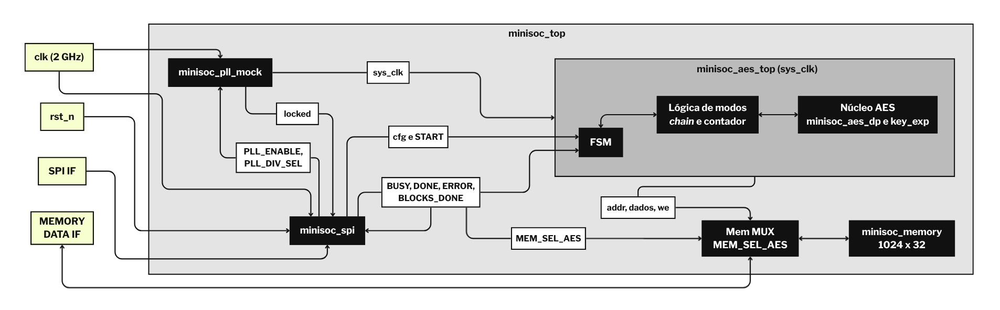
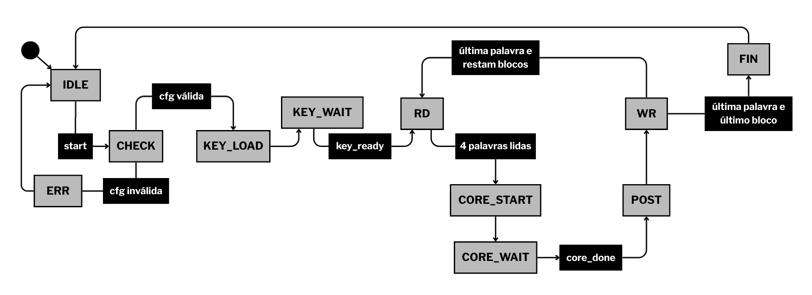

# [PT-BR] Microarquitetura do Mini-SoC AES (v1.0) - trilha de Design RTL

O presente documento apresenta o detalhamento da microarquitetura do sistema do acelerador AES com interface SPI (v1.0).

## 1. Microarquitetura do sistema (`minisoc_top`)

O `minisoc_top` integra quatro blocos, que são:  **SPI** (controle de dados por meio do protocolo SPI), o **PLL** (geração do sinal de *clock*), o **AES** (os módulos responsáveis pela criptografia em si) e a **memória compartilhada** (1024 x 32 bits). O usuário usa o **SPI** para configurar o sistema e a interface **MEMORY DATA** para ler e escrever a memória, como explicado pelo documento *Block Guide* do MiniSoC AES.

### 1.1. Operação do sistema

1. O usuário grava os blocos de entrada na memória pela interface **MEMORY DATA**.
2. Pelo **SPI**, configura chave, modo e número de blocos, e habilita o *mock* do **PLL**.
3. Quando o **PLL** indica `locked`, o `sys_clk` é liberado para o **AES**.
4. O usuário entrega a memória ao **AES** (`MEM_SEL_AES = 1`) e envia `START`.
5. O **AES** processa os blocos, sobrescrevendo-os na própria memória, e o *status* indica `DONE`.
6. O usuário devolve a memória (`MEM_SEL_AES = 0`) e lê os resultados.

### 1.2. Diagrama expandido de blocos do sistema

O diagrama de blocos a seguir retrata de forma geral a estrutura interna dos quatro blocos, **SPI**, **PLL**, **AES** e a **memória compartilhada**. Uma forma mais simples desse diagrama está contida no documento de especificação **Block Guide – MiniSoC AES**. Para outros detalhes não apresentados aqui, vale conferir o referido documento de especificação. Serão explicadas suas funções nos próximos títulos e subtítulos.

### 1.3. RTL dos blocos do sistema e tomada de decisão

Dentro da pasta `rtl/`, existem as quatro seguintes pastas: `minisoc_aes`, `minisoc_mem`, `minisoc_pll` e `minisoc_spi`. Cada pasta, em suma, é um bloco do sistema, reunidos de modo modularizado em `minisoc_top.sv`, como visto no diagrama expandido, nos blocos de cor preta. Os principais arquivos são:

| **Arquivos RTL** | **Função** |
| --- | --- |
| `minisoc_top.sv` | Reúne e liga de modo funcional todos os blocos do sistema. |
| `minisoc_aes/minisoc_aes_top.sv` | Reúne e liga de modo funcional os blocos de criptografia AES, além da FSM. |
| `minisoc_aes/minisoc_aes_dp.sv` | *Datapath* (decisões lógicas) da criptografia AES. |
| `minisoc_aes/minisoc_aes_key_exp.sv` | Módulo que expande as chaves de rodada. |
| `minisoc_aes/minisoc_aes_add_round_key.sv`, `minisoc_aes_mix_columns.sv`, `minisoc_aes_sbox.sv`, `minisoc_aes_shift_rows.sv`, `minisoc_aes_sub_bytes.sv` e suas inversas. | Transformações de rodada. |
| `minisoc_mem/minisoc_memory.sv` | Memória compartilhada 1024 x 32. |
| `minisoc_pll/minisoc_pll_mock.sv` | Geração do sinal de *clock* mockado (em 2 GHz e outras frequências). |
| `minisoc_spi/minisoc_spi.sv` | Módulo SPI e banco de registradores. |

As quatro pastas do sistema se integram entre si por muitos sinais. Este documento deve ser breve em explicar isso.

O sistema do `minisoc_pll` se preocupa em pegar o sinal de *clock* de referência (`clk`) e o *reset* (`rst_n`) para gerar os domínios utilizados pelo sistema. O PLL é configurado via SPI (`PLL_ENABLE` e `PLL_DIV_SEL`) para gerar o *clock* de sistema (`sys_clk`) reduzido por divisores (**/1**, **/2**, **/4** ou **/8**). Enquanto o PLL está ligando, o sinal `locked` fica em nível lógico baixo (**0**). Enquanto isso, a lógica de controle do sistema deve impedir que o *clock* gerado chegue ao núcleo do AES. Assim que o PLL estabiliza a frequência, ele ativa o sinal `o_locked` para nível lógico alto (**1**). Como aponta o documento de especificação *Block Guide* do Mini-SoC AES, o *clock* deve ficar travado por um tempo para inicializar de forma segura.

O sistema do `minisoc_spi` atua como um meio de interface de comunicação entre o usuário e a máquina de criptografia AES. Além disso, armazena os parâmetros fundamentais para a criptografia num banco de registradores (chaves, vetores de inicialização, contadores, modo de operação e quantidade de blocos) e gerencia os comandos de disparo (`START`). Muitos sinais utilizados pelo sistema possuem o prefixo `cfg`, e diz respeito aos parâmetros e dados de configuração que definem o comportamento do acelerador antes do comando de disparo (`START`). O sistema do `minisoc_spi` também recolhe do AES os sinais de andamento e término (`BUSY`, `DONE`, `ERROR`, `BLOCKS_DONE`) para consulta posterior num software pelo usuário.

O sistema do `minisoc_aes`, que será melhor explicado nos subtítulos seguintes, coordena a máquina de estados do sistema (FSM), a lógica de modos e encadeamento (`mode`), que gerencia os modos de operação do AES especificados no documento de especificação *Block Guide* do Mini-SoC AES (**ECB**, **CBC**, **PCBC**, **CFB**, **OFB** e **CTR**), e coordena o *datapath* iterativo (`core`), que engloba o núcleo de 11 ciclos por bloco (`minisoc_aes_dp`) e a expansão de chaves pré-computada (`minisoc_aes_key_exp`), executando as transformações de cifragem e decrifragem.

Por fim, a memória do sistema e seu controle está em `minisoc_mem`, dividido entre `minisoc_memory` e o MUX. O `minisoc_memory` é onde os dados são gravados inicialmente e onde os textos cifrados são sobrescritos. No MUX, que é basicamente um seletor, seleciona o nível lógico do sinal `MEM_SEL_AES` por meio da interface SPI, definindo quem tem a propriedade da memória a cada momento. Ou seja, se `MEM_SEL_AES = 0`, a memória fica sob o controle da interface externa (`MEMORY DATA IF`). Se `MEM_SEL_AES = 1`, a propriedade é entregue ao AES para o processamento com os sinais `addr`, `dados` e `we`.

## 2. Microarquitetura do AES (`minisoc_aes`)

O módulo principal de criptografia AES é o **minisoc_aes_top**, visto anteriormente no diagrama de blocos, e que reúne de forma modularizada vários módulos com a lógica dessa criptografia. Este título será focado na descrição da microarquitetura dessa parte do sistema.

A microarquitetura decidida para o AES é **iterativa**, com uma rodada por ciclo de *clock*. Um único bloco de rodada (**SubBytes, ShiftRows, MixColumns** e **AddRoundKey**) é reaproveitado 10 vezes, com um registrador de estado de 128 bits que guarda o resultado de cada rodada e o realimenta na entrada do mesmo bloco. Antes da primeira rodada há um ciclo de carga, em que o dado passa pelo **AddRoundKey**, então cada bloco leva 11 ciclos no núcleo (AES-128). Como a última rodada não tem **MixColumns**, o circuito a contorna.

Na decifragem, o mesmo esquema usa as transformações inversas (**InvShiftRows, InvSubBytes** e **InvMixColumns**) e as chaves de rodada em ordem inversa. As chaves são geradas pelo **minisoc_aes_key_exp**, uma por ciclo, e guardadas em registradores. Será abordado um pouco mais sobre a geração de chaves desse módulo no subtítulo **2.1.**

### 2.1. Chaves de rodada

O `minisoc_aes_key_exp` recebe a chave de 128 bits capturada no estado inicial da FSM, **START**, e gera **K0** (chave 0) a **K10** (chave 10) em 10 ciclos, uma por ciclo, guardando as chaves em 11 registradores de 128 bits (**K0** é a chave original). Ao terminar, sinaliza *ready* e serve a chave pedida por um índice chamado **round_idx**: de 0 a 10 na cifragem (operações diretas) e de 10 a 0 na decifragem (operações inversas). A expansão ocorre uma vez por **START** e vale para todos os blocos da operação. Ou seja, as chaves são pré-computadas. Desse modo, a decifragem fica mais simples (só inverte o índice, sem expansão inversa).

Porém, o custo de flip-flops fica maior. Para uma abordagem de baixo-custo e priorizando recursos, a abordagem pré-computada acabou sendo escolhida pela simplicidade de controle dessa lógica do AES, que acaba sendo melhor para o desenvolvimento. Contudo, vale conversar com o instrutor sobre isso.

### 2.2. Interface do núcleo do *datapath* (`minisoc_aes_dp`)

O módulo `minisoc_aes_dp` encapsula o núcleo iterativo e gerencia o consumo das chaves e das transformações por meio de sinais de controle internos:

- **Seleção de chaves de rodada (`rk_sel`)**: o *datapath* calcula o índice da chave requisitada ao `minisoc_aes_key_exp` com base no estado atual:
    - Em repouso (`!busy_q`): seleciona `4'd0` para cifragem ou `4'd10` para decifragem.
    - Em execução (`busy_q = 1`): para cifragem, caminha de `4'd1` a `4'd10` (`round_q`); para decifragem, consome em ordem reversa (`4'd10 - round_q`).
- ***Path* da cifragem**: dá início em `load_state`, aplica-se o **AddRoundKey** (`u_ark_load`) entre o dado de entrada (`data_i`) e a chave inicial. Nas rodadas de 1 a 9, o estado passa de modo sequencial por **SubBytes**, **ShiftRows**, **MixColumns** e **AddRoundKey** (`u_ark_round`). Na rodada 10 (`last_round`), o multiplexador interno contorna o `MixColumns` (`last_round ? sr_out : mc_out`).
- ***Path* da decifragem**: utiliza as transformações inversas (**InvShiftRows**, **InvSubBytes**, **AddRoundKey** compartilhado e **InvMixColumns**). Da mesma forma que na cifragem, o estágio de **InvMixColumns** é omitido na última rodada.
- **Controle da FSM interno**: Controlado pelos sinais `start_ok` (condicionado a `start_i && key_ready_o && !busy_q`), gerencia o incremento de `round_q` até 10, gerando o pulso de conclusão (`done_o`) e atualizando o registrador de estado `state_q`.

## 3. Máquina de estados (FSM) do RTL do topo (`minisoc_aes_top`)

Neste título, será abordada a construção idealizada da máquina de estados (FSM) do sistema de topo do AES, presente em `minisoc_aes_top`.

### 3.1. Interface

A máquina de estados interage com o banco de registradores do SPI e com o núcleo do AES através de muitos sinais, mas explicados de modo básico a seguir:

- **Entradas de controle**: `start` (disparo pelo registrador `AES_CONTROL`), `decrypt` (seleção de cifra/decifra), `mode` (modo de operação) e `num_blocks` (quantidade de blocos de 1 a 256).
- **Sinais de *handshake* e *status***: `key_ready` (indicando que as chaves de rodada foram expandidas), `core_done` (sinal de término do *datapath* de 11 ciclos) e *flags* internas de controle de *loop* de blocos.
- **Comandos de saída**: Sinais de controle de leitura/escrita para a memória compartilhada, ativação do *datapath* e atualização dos registradores de status (`BUSY`, `DONE`, `ERROR`, `BLOCKS_DONE`).

### 3.2. Estados

Os estados do módulo do topo do Mini-SoC AES são os seguintes:

- **IDLE**: início da FSM, esperando o estado **CHECK**. Aqui, a FSM monitora a requisição de início (`start`) combinada com a verificação de que a memória pertence ao AES (`MEM_SEL_AES == 1`).
- **CHECK**: Realiza a validação dos parâmetros de configuração recebidos via SPI (`NUM_BLOCKS` entre 1 e 256, e `MODE` compatível entre `000` e `101`). Caso a configuração seja inválida, transita para o estado **ERR**. caso contrário, prossegue para o carregamento de chaves.
- **KEY_LOAD**: aciona o módulo de expansão de chaves (`minisoc_aes_key_exp`) com a chave de 128 bits.
- **KEY_WAIT**: estado que aguarda o sinal de prontidão (`key_ready`) que indica que todas as 11 chaves de rodada foram pré-computadas e armazenadas.
- **RD**: executa a leitura de forma sequencial de 4 palavras consecutivas dos 32 bits da memória compartilhada correspondentes ao bloco AES atual (base do bloco até base + 3), montando o bloco de 128 bits.
- **CORE_START**: aciona o núcleo do *datapath* (`minisoc_aes_dp`), fornecendo o bloco de dados de entrada e disparando o processamento iterativo.
- **CORE_WAIT**: estado que aguarda a conclusão dos 11 ciclos de execução do datapath (`core_done`).
- **POST**: executa o pós-processamento específico dos modos de operação (por exemplo, operações de XOR para encadeamento em **CBC**, **CFB**, **OFB** ou **CTR**).
- **WR**: estado que escreve as 4 palavras resultantes de volta na mesma região da memória compartilhada. E incrementa o contador de blocos processados (`BLOCKS_DONE`).
- **FIN**: estado que indica o final das operações da FSM, com a *flag* `DONE = 1` no registrador de *status* do SPI, voltando ao estado **IDLE**.
- **ERR**: estado de erro da FSM (`ERROR = 1`), voltando ao estado **IDLE**.

Há um *loop* que pode ser visto no diagrama de estados do próximo subtítulo, (**WR** -> **RD** ou **FIN**) que indica que, se ainda restarem blocos a serem processados (`blocks_done < num_blocks`), a FSM retorna ao estado **RD** para o próximo bloco. Caso contrário, avança para **FIN**.

### 3.3. Diagrama de estados

A seguir, o diagrama de estados conectando os estado explicados no subtítulo anterior:

## 4. Domínios de *clock* e estratégia de CDC (*Clock Domain Crossing*)

O sistema deve operar com os seguintes domínios de *clock*:

| Domínio de *clock* | Frequência náxima/alvo | Blocos associados |
| --- | --- | --- |
| `clk` | 2 GHz. | Banco de registradores do `minisoc_spi`, lógica de controle e modelo do PLL. |
| `spi_sclk` | Até 25MHz. | Deslocador serial de entrada e saída do SPI. |
| `sys_clk` | 250 MHz a 2 GHz | `minisoc_aes_top` (FSM, núcleo iterativo e expansão de chaves, etc.) |
| `mem_clk` | Até 200 MHz. | Interface externa de acesso à memória compartilhada. |

Todos os sinais de *clock* são tratados como assíncronos entre si, e por isso são necessárias metodologias ou estratégias de travessia para evitar metaestabilidade. Os subtítulos a seguir abordarão quais poderão ser as travessias e quais tipos de estratégias pode ser feita com relação a elas.

### 4.1. Travessia de `spi_sclk` para `clk`

Conforme o documento de especificação *Block Guide* do Mini-SoC AES, a comunicação serial ocorre com `spi_sclk`, enquanto o banco de registradores é atualizado com `clk`. Aqui, realiza-se a sincronização por *toggle*, por meio dos seguintes passos:

1. O barramento SPI recebe 40 bits de dados bit a bit, que foi definido também no documento de especificação, que é o *frame* de transação que o mestre externo envia através do pino SPI `spi_mosi`. Seu cabeçalho e outros detalhes também estão definidos no documento de especificação. Ao completar o 40º bit, o *frame* é copiado para um registrador de retenção (`frame_hold`) e o sinal `frame_toggle` inverte de estado (se estava em 0, vai para 1, e se estava em 1, vai para 0), para avisar que o final da transmissão do pacote.
2. No domínio `clk`, o sinal de *toggle*, que é o `frame_toggle`, passa por uma cadeia de dois flip-flops de sincronização, seguida por um terceiro para detecção de borda (`frame_valid = tog_s2 ^ tog_s3`).
3. Depois, o `frame_valid` atua como um sinal de habilitação para que o conteúdo de 40 bits que foi retido em `frame_hold` seja lido e decodificado no domínio `clk`. Se for uma operação de escrita, o registrador correspondente do banco SPI é atualizado, e se for uma operação de leitura, o endereço solicitado é processado para a captura do dado.

### 4.2. Travessia de `clk` para `sys_clk`

O sinal `START` do `minisoc_spi` deve atravessar de `clk` para `sys_clk` passando por um circuito de *toggle*, parecido com o visto na travessia de `spi_sclk` para `clk.` Nesse circuito, o sinal de origem inverte de estado, é sincronizado por flip-flops no destino e passa por um detector de borda para gerar um pulso de um ciclo de `sys_clk`.

### 4.3. Travessia de `sys_clk` para `clk`

A travessia de `sys_clk` para `clk` utiliza sincronizadores de dois flip-flops para as *flags* de estado `BUSY`, `ERROR` e `DONE`. Para o contador `BLOCKS_DONE`, deve-se empregar codificação em código Gray para que um bit mude por vez durante a travessia.

### 4.4. Sinal `MEM_SEL_AES`

O sinal `MEM_SEL_AES` deve cruzar para `sys_clk` e `mem_clk` através de sincronizadores de dois flip-flops também.

## 5. Sequência de *reset* de `sys_clk`

O sinal de *reset* global `rst_n` é assíncrono. Conforme o documento de especificação *Block Guide* do Mini-SoC AES, a memória compartilhada não é apagada pelo *reset* global, só a lógica de controle do sistema que é reinicializada.

### **5.1. Fases da Sequência de reset**

A sequência de *reset* do sistema pode ser compreendida da seguinte forma:

1. Quando `rst_n = 0`, todos os domínios entram em *reset* de forma assíncrona. O PLL fica desabilitado (`PLL_ENABLE = 0`, `PLL_LOCKED = 0`) e o `sys_clk` fica parado.
2. Quando `rst_n = 1`, o domínio `clk` sai do *reset* após sincronização, fazendo com que o software configure o `PLL_DIV_SEL` e ative `PLL_ENABLE = 1` via SPI.
3. Depois, o modelo de PLL aguarda o tempo de *lock*, faz o sinal `PLL_LOCKED = 1` e libera o *clock* gerado `sys_clk`.
4. O *reset* do domínio do AES deve ser liberado por uma cadeia síncrona de 8 flip-flops operando em `sys_clk` (`SYS_RST_CYCLES`).
5. Por fim, com o término da contagem da cadeia de *reset*, a FSM atinge o estado `IDLE`, ficando apta a receber novas ordens do `START`.
